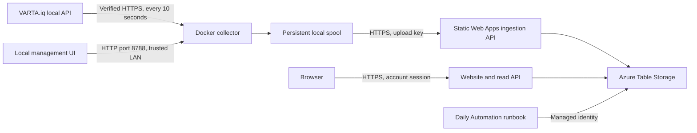

# ADR 0001: Docker collector and private Azure viewer

- Status: Accepted for the implemented architecture; the export API below remains proposed
- Date: 2026-10-16
- Scope: Collector, cloud ingestion, storage, website, authentication, and retention

## Context

A VARTA.iq Energy Manager exposes measurements and device information on the local network. We need to collect both endpoints every ten seconds, preserve data during internet outages, and display current and historical measurements remotely at low operating cost.

The collector must run independently of the existing local viewer, including on a Raspberry Pi. Its local management interface must expose configuration, separate acquisition and upload statuses, and the last ten errors. Cloud data must remain private, and retention must work even when the collector is switched off.

The initial plan used Microsoft Entra sign-in and invited Static Web Apps viewer roles. Organization consent blocked this sign-in. The implemented decision uses application-managed accounts instead. The initial local HTTPS/password requirement was also replaced, at the owner's request, with HTTP without a password on the trusted LAN.

## Decision

### Components and boundaries

Keep this project in its own repository, separate from [the local viewer](https://github.com/kko/varta.iq-viewer). Reuse its frontend presentation components without requiring its server to run.



Use Static Web Apps Free with an integrated Node.js 22 API, Standard LRS Table Storage, and a daily Azure Automation runbook. Default provisioning region is West Europe. The website uses the Azure-provided domain initially.

### Collection and local operation

- Ship a dedicated Docker image and Compose service for x64, ARM64, and ARMv7, with separate persistent configuration and data volumes and automatic container restart.
- Poll `/v2/point` and `/v2/devices` independently every ten seconds. A failure of either endpoint must not discard the successful response from the other.
- Verify gateway HTTPS using the configured certificate trust/pinning mechanism and send the optional VARTA API key only to the configured gateway.
- Create one packet per collection cycle with its packet ID, collector ID, creation time, endpoint attempt/receipt times, available original response data, and endpoint errors.
- Persist packets before sending them. Remove them only after Azure explicitly acknowledges storage. Retries retain the packet ID.
- Keep an outage spool for up to 30 days, favor current packets while draining older packets, and use bounded batches and retry backoff. Expired packet counts remain visible. This is time-based retention, not a guarantee of sufficient disk capacity.
- Expose the local management UI on HTTP port 8788 without a password. Restrict accepted hosts and validate the origin and JSON content of mutation requests. This interface belongs on a trusted LAN.
- Store secrets server-side; return presence flags instead of saved keys. Send the Azure upload key only to the configured HTTPS ingestion URL, with redirects disabled.
- Show acquisition attempts/successes separately for each endpoint, current upload acknowledgments, latest measurement time, spool count/oldest time, and the persistent last ten redacted errors. Mark data stale after 30 seconds without a current success; successful operations do not erase error history.
- Offer German and English through a dropdown. Save the preference in the browser and preserve unsaved input when switching languages.

### Ingestion and storage

Authenticate `POST /api/ingest` with a dedicated upload key. Accept a single packet or a bounded batch of up to 20 packets. Acknowledge packets only after their required writes have completed.

Use UTC daily tables named `VartaYYYYMMDD`. The `PartitionKey` is the collector ID. Each entity's `payload` property contains JSON.

| Row key | Meaning | Day used for its table |
| --- | --- | --- |
| `p:<createdAt>:<packetId>` | Complete collection packet, including both endpoint results and status | Packet creation day |
| `m:<gatewayTimestamp>` | Original point measurement, deduplicated by collector and gateway timestamp | Measurement day |
| `a300:<bucketStart>` | Five-minute aggregate | Measurement day |
| `a3600:<bucketStart>` | Hourly aggregate | Measurement day |
| `a86400:<bucketStart>` | Daily aggregate | Measurement day |

Original responses mean their parsed JSON content, not a byte-for-byte HTTP response archive. Headers and credentials are not part of the raw packet payload.

Create each new measurement and update its three aggregate buckets in one same-partition transaction, using ETags for concurrent updates. Packet storage and latest-status writes are separate operations: replay repairs interrupted work, and uniqueness prevents duplicate measurements or packet rows. The overall ingest is not one transaction across all tables.

Keep latest point/device responses and operational status in `VartaMeta`. Store accounts, hashed sessions, and login rate-limit records separately in `VartaAuth`.

### Website and access control

Reuse the viewer's metrics, device mapping, original JSON views, and charts. Provide month-length, year, and custom date ranges, with visible gaps rather than invented zero values. Display chart times in Europe/Berlin while keeping storage boundaries in UTC.

| Requested range | Chart interval |
| --- | --- |
| Up to one hour | Ten seconds |
| Up to 24 hours | One minute |
| Up to seven days | Five minutes |
| Up to 90 days | One hour |
| Longer ranges | One day |

The static HTML and JavaScript contain no measurements or credentials. Enforce authorization on every data API request: `GET /api/point`, `/api/devices`, `/api/history`, and `/api/status` require a valid application session and completion of any mandatory password change.

Use a secret, one-time setup link to create the first administrator with a chosen username, email, and password. Do not ship a shared default administrator password or permit public self-registration. Only administrators can create further users, assign viewer/admin roles, disable accounts, or reset temporary passwords. Require users to change administrator-issued temporary passwords before accessing data.

Hash passwords using individual salts and PBKDF2-HMAC-SHA256 with 600,000 iterations. Use random session tokens, store their hashes, and issue Secure, HttpOnly, SameSite=Strict cookies with an eight-hour lifetime. Persist login rate limits, invalidate sessions after password/role changes or account disabling, and protect the last active administrator from being disabled or demoted.

The upload key remains independent of website accounts. Email is a login identifier; email verification/delivery, MFA, and automatic email-based recovery are not currently implemented. A managed identity provider should be reconsidered for larger or more sensitive deployments.

### Retention, provisioning, and cost

Retain 365 UTC calendar days including today. Reject uploads outside this window. A daily Automation runbook, authorized through a managed identity, removes expired daily tables and stale latest-response data, and cleans expired session/rate-limit records. Expose cleanup time and failures in cloud status. Cleanup must not depend on the Pi being online.

Provision with a repeatable PowerShell script and Bicep after Azure CLI sign-in. Preserve existing upload keys and users on reruns; rotate the upload key only when explicitly requested. Generate deployment artifacts from source and keep credentials, local configuration, buffered packets, and generated output out of Git.

Select the free website tier to reduce baseline cost, but do not promise a free overall service. Storage, transactions, automation usage beyond applicable allowances, and other usage may incur charges. Estimate costs using current pricing and representative packet sizes rather than a fixed amount in this ADR.

## Alternatives considered

| Alternative | Reason for the decision |
| --- | --- |
| Extend the original viewer process | A separate collector can run continuously on the Pi and deploy independently. |
| Keep history only on the Pi | Remote access and retention would depend on local hardware availability. |
| Scan all raw packets for long-range charts | Precomputed aggregates bound the work for year-length views. |
| Run retention in the collector | Cleanup would stop during a collector outage. |
| Require organization-managed Microsoft login | Organization consent was unavailable; application accounts allow this deployment to proceed. |
| Public cloud data access | Replaced by server-enforced account authentication to keep measurements private. |
| Shared default administrator password | Replaced by a protected setup link and an owner-chosen password. |

## Consequences

- Collection survives ordinary network outages and container restarts, subject to disk capacity and the 30-day spool window.
- Current uploads, historical backfill, and chart aggregates can coexist without counting replayed measurements twice.
- UTC retention and Europe/Berlin display times have different boundaries, which integrations must handle explicitly.
- Application-managed authentication introduces security maintenance work that a managed provider would otherwise handle.
- A reader granted access to the entire storage account can also read `VartaAuth`; external integrations must not receive that broad access casually.
- Storage and API schemas are application-owned contracts and require deliberate versioning when integrations depend on them.

## Follow-up proposal: raw-data export for other services

This section records the integration plan discussed after implementation. It is **proposed and not implemented** by this ADR.

Add a paginated read-only endpoint such as:

```http
GET /api/export?from=<UTC-time>&to=<UTC-time>&cursor=<opaque-cursor>
Authorization: Bearer <dedicated-read-credential>
```

It would return complete `p:` packet payloads without exposing storage credentials, authentication tables, or the internal table layout. Its machine credential would be independent of both the collector upload key and human browser sessions.

The existing `/api/history` endpoint returns chart-oriented values and aggregates, not a complete original-packet export. Existing session-authenticated endpoints can serve current values but do not provide a dedicated machine-to-machine authentication contract.

Before accepting or implementing the export proposal, specify:

1. Read-credential issuance, scope, rotation, revocation, and rate limits.
2. Response schema, API versioning, page limits, and opaque cursor behavior.
3. Incremental delivery semantics for packets uploaded as much as 30 days late. A checkpoint based only on packet creation or measurement time can miss backfill; use a reliable Azure-arrival cursor/index or a defined retrospective reconciliation strategy.
4. Idempotent consumption using packet IDs and behavior at retention boundaries.
5. Isolation from `VartaAuth`, and integration tests for unauthorized access, pagination, replay, and delayed arrival.

Direct Table Storage reads remain an alternative for trusted services with suitable scoped permissions. They couple consumers to the storage schema and require their own pagination, retention handling, and backfill reconciliation.

## Validation

The acceptance plan covers gateway certificate/API-key failures, independent endpoint failures, Azure timeouts, replay, restart recovery, backlog draining, and spool expiry. Storage integration tests cover duplicate packets, concurrency, ETags, and aggregate correctness. Browser tests cover date ranges, mobile layout, account setup, mandatory password changes, role boundaries, and language persistence.

Deployment acceptance additionally requires sustained ten-second collection, an outage/restart/backfill exercise, year-range rendering, and independent cleanup with the collector stopped. These are validation requirements, not an assertion that every deployment has completed every exercise.

## Related documentation and implementation

- [Project overview and quick start](../../README.md)
- [Operating instructions (German)](../../COLLECTOR.md)
- [Collector and spool](../../collector/engine.mjs)
- [Ingestion, raw storage, and aggregation](../../cloud/api/src/service.mjs)
- [Application authentication](../../cloud/api/src/auth.mjs)
- [Infrastructure](../../cloud/infra/main.bicep)
- [Independent retention runbook](../../cloud/infra/retention.ps1)
